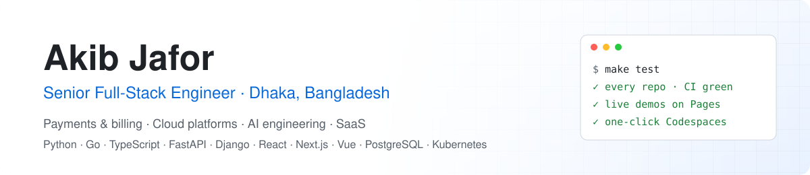

<!-- topics: portfolio, profile -->
<picture>
  <source media="(prefers-color-scheme: dark)" srcset="assets/banner-dark.svg">
  
</picture>

  
  

I'm a senior full-stack engineer in Dhaka with six-plus years shipping production systems in FinTech, cloud infrastructure, AgriTech and retail. I build the whole product: Python and Go backends, React / Next.js / Vue frontends in TypeScript, and the Docker, Kubernetes and OpenStack infrastructure underneath.

- **Now:** Sr. Software Engineer at GenNext Technologies, building an OpenStack-based cloud platform for Bangladesh: compute, billing, usage metering and multi-tenant auth.
- **Before:** payment gateways and billing/settlement for mobile financial services and banks, a KYC onboarding system for a bank's mobile app, and AWD irrigation monitoring for Japanese agricultural consultants.
- **Here:** every repository is a complete, tested project with CI, a live demo or API reference, and one-click Codespaces.

  

## Try these live

No install, no sign-up: each opens a running demo in your browser.

<table>
  <tr>
    <td width="50%" valign="top">
      
      <b><a href="https://akibullah.github.io/react-admin-dashboard/">E-commerce admin dashboard</a></b> 
      React 18, TypeScript, TanStack Query, Recharts on a mocked API. Sign in with <code>admin@shopbd.test</code> / <code>password123</code>.
      · <a href="https://github.com/AkibUllah/react-admin-dashboard">code</a>
    </td>
    <td width="50%" valign="top">
      
      <b><a href="https://akibullah.github.io/rag-eval-lab/">Bilingual RAG with evaluation</a></b> 
      English/Bangla Q&amp;A with cited answers, retrieval running in the browser, and measured recall@k / MRR.
      · <a href="https://github.com/AkibUllah/rag-eval-lab">code</a>
    </td>
  </tr>
  <tr>
    <td width="50%" valign="top">
      
      <b><a href="https://akibullah.github.io/ai-support-agent/">Tool-calling support agent</a></b> 
      Refunds, order tracking and escalation with policy guardrails; every tool call visible. 53/53 eval scenarios pass.
      · <a href="https://github.com/AkibUllah/ai-support-agent">code</a>
    </td>
    <td width="50%" valign="top">
      
      <b><a href="https://akibullah.github.io/vue-cloud-console/">Cloud console</a></b> 
      Vue 3 + Pinia tenant console: quotas, launch wizard, volumes, security groups, billing. Any email + 6-char password.
      · <a href="https://github.com/AkibUllah/vue-cloud-console">code</a>
    </td>
  </tr>
</table>

More demos: [form builder](https://akibullah.github.io/react-form-builder/) · [Bangla i18n playground](https://akibullah.github.io/bangla-i18n-toolkit/) · [log analytics report](https://akibullah.github.io/log-analytics-pipeline/) · API references for every backend on its repo's homepage link.

## Projects

### AI engineering

| Repo | What it is |
|---|---|
| [rag-eval-lab](https://github.com/AkibUllah/rag-eval-lab) | Bilingual (English/Bangla) document Q&A with a measured comparison of chunkers and retrievers: recall@k, MRR, nDCG, citation precision. [Live demo](https://akibullah.github.io/rag-eval-lab/) runs search in the browser. |
| [ai-support-agent](https://github.com/AkibUllah/ai-support-agent) | Tool-calling support agent that looks up orders and issues refunds within policy, with guardrails, prompt-injection screening and a 53-scenario eval suite. [Live demo](https://akibullah.github.io/ai-support-agent/). |
| [llm-gateway](https://github.com/AkibUllah/llm-gateway) | OpenAI-compatible gateway in front of OpenAI, Anthropic and Ollama: fallback, circuit breakers, caching, virtual keys with budgets, cost tracking and streaming. |
| [mcp-postgres-analyst](https://github.com/AkibUllah/mcp-postgres-analyst) | Model Context Protocol server giving AI assistants safe read-only database access: SQL validation, row limits, column masking and an audit log. |

### Go and Kubernetes

| Repo | What it is |
|---|---|
| [go-api-gateway](https://github.com/AkibUllah/go-api-gateway) | Reverse-proxy API gateway in Go: JWT/JWKS, rate limiting, health-checked load balancing, circuit breakers, hot reload and Prometheus metrics. |
| [k8s-gitops-platform](https://github.com/AkibUllah/k8s-gitops-platform) | Helm library chart, Argo CD ApplicationSets and OPA policies deploying three of these services, tested end to end on a kind cluster in CI. |

### SaaS building blocks

| Repo | What it is |
|---|---|
| [saas-starter-kit](https://github.com/AkibUllah/saas-starter-kit) | Multi-tenant SaaS starter: FastAPI + Next.js 14, org switcher, team invites, roles, plan entitlements, API keys, billing page. |
| [saas-subscription-billing](https://github.com/AkibUllah/saas-subscription-billing) | Recurring billing engine: plans, seats, trials, coupons, exact proration, invoices, dunning and MRR/churn metrics. |
| [feature-flags-service](https://github.com/AkibUllah/feature-flags-service) | Feature flags with targeting rules, sticky percentage rollouts, segments, SSE streaming and Python/TypeScript SDKs. |
| [notification-service](https://github.com/AkibUllah/notification-service) | Email, SMS, push and in-app notifications with en/bn templates, preferences, quiet hours, digests and provider fallback. |
| [background-jobs-queue](https://github.com/AkibUllah/background-jobs-queue) | Redis-backed job queue with priorities, cron, retries, dependencies, stalled-job recovery and a React dashboard. |

### FinTech and payments

| Repo | What it is |
|---|---|
| [fastapi-payment-gateway](https://github.com/AkibUllah/fastapi-payment-gateway) | Multi-provider payment gateway with a payment state machine, idempotency keys, HMAC-signed webhooks, routing by fee table, settlement and reconciliation. |
| [billing-settlement-engine](https://github.com/AkibUllah/billing-settlement-engine) | Django + DRF double-entry ledger, tiered fee schedules, invoicing and partner settlement batches with CSV reconciliation. |
| [bkash-python-sdk](https://github.com/AkibUllah/bkash-python-sdk) | Typed sync/async Python client for bKash Tokenized Checkout with retries, token refresh and webhook helpers. |
| [webhook-relay](https://github.com/AkibUllah/webhook-relay) | Reliable webhook delivery service: exponential backoff, signatures, circuit breakers, dead-letter queue and replay. |
| [kyc-onboarding-api](https://github.com/AkibUllah/kyc-onboarding-api) | KYC onboarding workflow with document validation, NID checks, risk scoring, reviewer roles and SLA tracking. |

### Cloud platform and backend infrastructure

| Repo | What it is |
|---|---|
| [cloud-usage-metering](https://github.com/AkibUllah/cloud-usage-metering) | Usage ingestion, rating engine with tiered pricing and proration, invoices and budget alerts for cloud resources. |
| [multi-tenant-saas-auth](https://github.com/AkibUllah/multi-tenant-saas-auth) | Multi-tenant auth service: rotating refresh tokens, RBAC, org-scoped API keys, invitations and rate limiting. |
| [rate-limiter-service](https://github.com/AkibUllah/rate-limiter-service) | Token bucket, sliding window and GCRA limiters with in-memory and Redis (Lua) backends, plus FastAPI middleware and benchmarks. |
| [openstack-resource-manager](https://github.com/AkibUllah/openstack-resource-manager) | CLI to inventory, audit and cost-estimate OpenStack resources, with a fake cloud client for tests. |
| [realtime-monitoring-dashboard](https://github.com/AkibUllah/realtime-monitoring-dashboard) | FastAPI WebSocket metrics stream with alert rules and a React live dashboard. |
| [docker-fastapi-react-template](https://github.com/AkibUllah/docker-fastapi-react-template) | Production starter: async FastAPI + Alembic + Postgres + Redis, React frontend, nginx, compose for dev and prod, CI and deploy workflow. |
| [log-analytics-pipeline](https://github.com/AkibUllah/log-analytics-pipeline) | Nginx log parsing, path normalisation, percentiles and anomaly detection into DuckDB, with CLI and HTML reports. |
| [url-shortener-analytics](https://github.com/AkibUllah/url-shortener-analytics) | URL shortener with expiry, QR codes, Redis-cached redirects and click analytics. |

### E-commerce, retail and bookings

| Repo | What it is |
|---|---|
| [ecommerce-api](https://github.com/AkibUllah/ecommerce-api) | Django REST e-commerce backend: catalog, carts, stock reservation, coupons, bKash/COD checkout and delivery zones. |
| [appointment-booking-system](https://github.com/AkibUllah/appointment-booking-system) | Doctor appointment booking with timezone-aware slot generation, double-booking protection and reminders. |
| [inventory-forecasting](https://github.com/AkibUllah/inventory-forecasting) | Demand forecasting and reorder-point toolkit for retail POS data with backtesting. |

### Frontend engineering

| Repo | What it is |
|---|---|
| [react-admin-dashboard](https://github.com/AkibUllah/react-admin-dashboard) | React + TypeScript admin dashboard with TanStack Query, Zustand, Recharts, forms and a mocked API layer. |
| [react-form-builder](https://github.com/AkibUllah/react-form-builder) | Drag-and-drop form builder that exports JSON Schema and renders forms with zod validation. |
| [vue-cloud-console](https://github.com/AkibUllah/vue-cloud-console) | Vue 3 + Pinia cloud console UI: instance wizard, volumes, security groups, billing. |
| [bangla-i18n-toolkit](https://github.com/AkibUllah/bangla-i18n-toolkit) | Zero-dependency TypeScript library for Bangla numerals, BDT formatting, dates and phone validation. |

### AgriTech and reusable libraries

| Repo | What it is |
|---|---|
| [agri-field-monitor](https://github.com/AkibUllah/agri-field-monitor) | AWD irrigation monitoring backend with GraphQL API, field geometry, water-level alerts and progress reports. |
| [django-audit-log](https://github.com/AkibUllah/django-audit-log) | Reusable Django app for field-level audit trails with masking, request context and pruning. |

## Client products

Alongside these public repositories I maintain production products built for clients, including an offline-first point-of-sale system and a Next.js e-commerce storefront with English/Bangla support. Those codebases are private; demos and walkthroughs are available on request.

## Activity

  

## Contact

- Portfolio: https://akibullah.github.io/portfolio
- LinkedIn: https://www.linkedin.com/in/akib-jafor
- GitHub: https://github.com/AkibUllah

Open to senior backend / full-stack roles and freelance projects in payments, SaaS platforms and AI-backed products.
