<!-- topics: portfolio, profile -->
<picture>
  <source media="(prefers-color-scheme: dark)" srcset="assets/hero-dark.svg">
  
</picture>

  
  
  
  
  
  

I'm **Md. Akib Ullah Jafor** (Akib Jafor), a senior full-stack engineer in Dhaka, Bangladesh. I build complete products end to end: Python and Go services, TypeScript frontends, and the infrastructure that runs them. Six-plus years across FinTech, cloud platforms, AgriTech and retail.

<table>
  <tr>
    <td width="33%" valign="top"><b>💳 Payments &amp; billing</b> Gateways, idempotency, double-entry ledgers, settlement, KYC, subscription billing.</td>
    <td width="33%" valign="top"><b>☁️ Cloud &amp; platform</b> Multi-tenant auth, usage metering, rate limiting, job queues, durable workflows, Kubernetes, OpenStack.</td>
    <td width="33%" valign="top"><b>🧠 AI &amp; ML</b> Evaluated RAG, tool-calling agents with guardrails, MCP servers, LLM gateways, and published ML research.</td>
  </tr>
</table>

- **Now:** Senior Software Engineer building an OpenStack-based cloud platform for Bangladesh: compute, billing, usage metering and multi-tenant auth.
- **Before:** payment gateways and billing/settlement for mobile financial services and banks, KYC onboarding for a bank's mobile app, AWD irrigation monitoring for Japanese agricultural consultants.

<picture>
  <source media="(prefers-color-scheme: dark)" srcset="https://raw.githubusercontent.com/AkibUllah/AkibUllah/output/metrics-dark.svg">
  
</picture>

  

## ✦ Flagship projects

<table>
  <tr>
    <td width="50%"><a href="https://github.com/AkibUllah/saas-starter-kit"><picture><source media="(prefers-color-scheme: dark)" srcset="assets/cards/saas-starter-kit-dark.svg">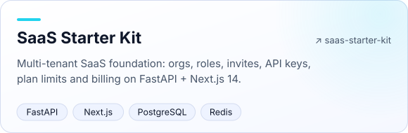</picture></a></td>
    <td width="50%"><a href="https://github.com/AkibUllah/rag-eval-lab"><picture><source media="(prefers-color-scheme: dark)" srcset="assets/cards/rag-eval-lab-dark.svg">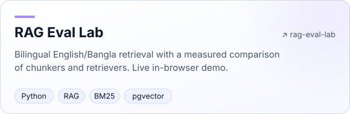</picture></a></td>
  </tr>
  <tr>
    <td width="50%"><a href="https://github.com/AkibUllah/ai-support-agent"><picture><source media="(prefers-color-scheme: dark)" srcset="assets/cards/ai-support-agent-dark.svg">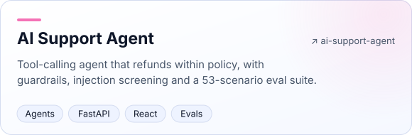</picture></a></td>
    <td width="50%"><a href="https://github.com/AkibUllah/fastapi-payment-gateway"><picture><source media="(prefers-color-scheme: dark)" srcset="assets/cards/fastapi-payment-gateway-dark.svg">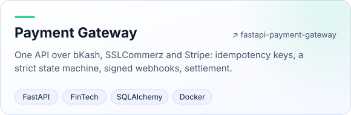</picture></a></td>
  </tr>
  <tr>
    <td width="50%"><a href="https://github.com/AkibUllah/webhook-relay"><picture><source media="(prefers-color-scheme: dark)" srcset="assets/cards/webhook-relay-dark.svg">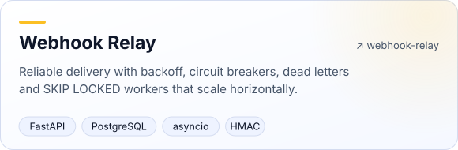</picture></a></td>
    <td width="50%"><a href="https://github.com/AkibUllah/go-api-gateway"><picture><source media="(prefers-color-scheme: dark)" srcset="assets/cards/go-api-gateway-dark.svg">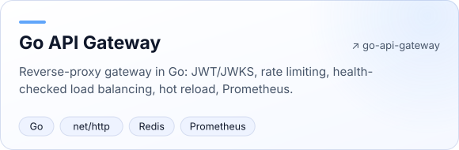</picture></a></td>
  </tr>
</table>

## ✦ Try these live

No install, no sign-up: each opens a running demo in your browser.

<table>
  <tr>
    <td width="50%" valign="top">
      <a href="https://akibullah.github.io/react-admin-dashboard/">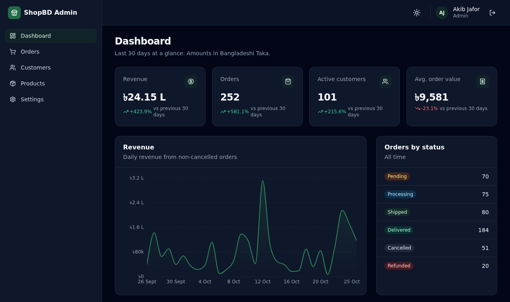</a>
      <b><a href="https://akibullah.github.io/react-admin-dashboard/">E-commerce admin dashboard</a></b> 
      React 18, TypeScript, TanStack Query, Recharts on a mocked API. Sign in with <code>admin@shopbd.test</code> / <code>password123</code>.
      · <a href="https://github.com/AkibUllah/react-admin-dashboard">code</a>
    </td>
    <td width="50%" valign="top">
      <a href="https://akibullah.github.io/rag-eval-lab/">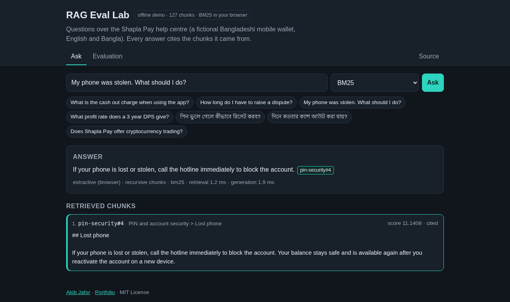</a>
      <b><a href="https://akibullah.github.io/rag-eval-lab/">Bilingual RAG with evaluation</a></b> 
      English/Bangla Q&amp;A with cited answers, retrieval running in the browser, and measured recall@k / MRR.
      · <a href="https://github.com/AkibUllah/rag-eval-lab">code</a>
    </td>
  </tr>
  <tr>
    <td width="50%" valign="top">
      <a href="https://akibullah.github.io/ai-support-agent/">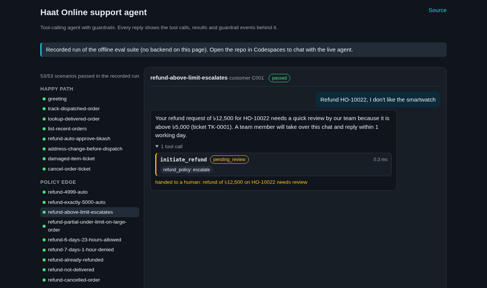</a>
      <b><a href="https://akibullah.github.io/ai-support-agent/">Tool-calling support agent</a></b> 
      Refunds, order tracking and escalation with policy guardrails; every tool call visible. 53/53 eval scenarios pass.
      · <a href="https://github.com/AkibUllah/ai-support-agent">code</a>
    </td>
    <td width="50%" valign="top">
      <a href="https://akibullah.github.io/vue-cloud-console/">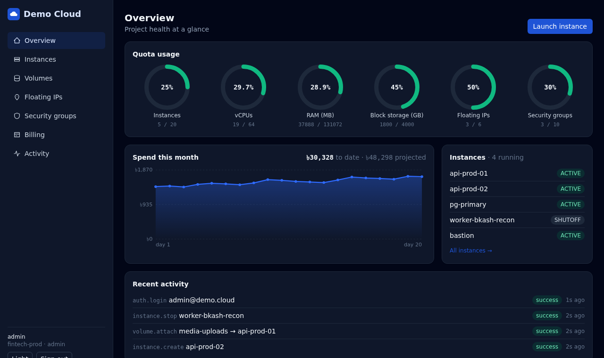</a>
      <b><a href="https://akibullah.github.io/vue-cloud-console/">Cloud console</a></b> 
      Vue 3 + Pinia tenant console: quotas, launch wizard, volumes, security groups, billing. Any email + 6-char password.
      · <a href="https://github.com/AkibUllah/vue-cloud-console">code</a>
    </td>
  </tr>
</table>

More demos: [form builder](https://akibullah.github.io/react-form-builder/) · [Bangla i18n playground](https://akibullah.github.io/bangla-i18n-toolkit/) · [log analytics report](https://akibullah.github.io/log-analytics-pipeline/) · API references for every backend on its repo's homepage link.

## ✦ All projects

Every repository is a complete project with tests, CI, security scanning, releases and a live demo, API reference or one-click Codespace.

<b>AI engineering</b> · 4 projects

| Repo | What it is |
|---|---|
| [rag-eval-lab](https://github.com/AkibUllah/rag-eval-lab) | Bilingual (English/Bangla) document Q&A with a measured comparison of chunkers and retrievers: recall@k, MRR, nDCG, citation precision. [Live demo](https://akibullah.github.io/rag-eval-lab/) runs search in the browser. |
| [ai-support-agent](https://github.com/AkibUllah/ai-support-agent) | Tool-calling support agent that looks up orders and issues refunds within policy, with guardrails, prompt-injection screening and a 53-scenario eval suite. [Live demo](https://akibullah.github.io/ai-support-agent/). |
| [llm-gateway](https://github.com/AkibUllah/llm-gateway) | OpenAI-compatible gateway in front of OpenAI, Anthropic and Ollama: fallback, circuit breakers, caching, virtual keys with budgets, cost tracking and streaming. |
| [mcp-postgres-analyst](https://github.com/AkibUllah/mcp-postgres-analyst) | Model Context Protocol server giving AI assistants safe read-only database access: SQL validation, row limits, column masking and an audit log. |

<b>Go and Kubernetes</b> · 2 projects

| Repo | What it is |
|---|---|
| [go-api-gateway](https://github.com/AkibUllah/go-api-gateway) | Reverse-proxy API gateway in Go: JWT/JWKS, rate limiting, health-checked load balancing, circuit breakers, hot reload and Prometheus metrics. |
| [k8s-gitops-platform](https://github.com/AkibUllah/k8s-gitops-platform) | Helm library chart, Argo CD ApplicationSets and OPA policies deploying three of these services, tested end to end on a kind cluster in CI. |

<b>SaaS building blocks</b> · 5 projects

| Repo | What it is |
|---|---|
| [saas-starter-kit](https://github.com/AkibUllah/saas-starter-kit) | Multi-tenant SaaS starter: FastAPI + Next.js 14, org switcher, team invites, roles, plan entitlements, API keys, billing page. |
| [saas-subscription-billing](https://github.com/AkibUllah/saas-subscription-billing) | Recurring billing engine: plans, seats, trials, coupons, exact proration, invoices, dunning and MRR/churn metrics. |
| [feature-flags-service](https://github.com/AkibUllah/feature-flags-service) | Feature flags with targeting rules, sticky percentage rollouts, segments, SSE streaming and Python/TypeScript SDKs. |
| [notification-service](https://github.com/AkibUllah/notification-service) | Email, SMS, push and in-app notifications with en/bn templates, preferences, quiet hours, digests and provider fallback. |
| [background-jobs-queue](https://github.com/AkibUllah/background-jobs-queue) | Redis-backed job queue with priorities, cron, retries, dependencies, stalled-job recovery and a React dashboard. |

<b>FinTech and payments</b> · 5 projects

| Repo | What it is |
|---|---|
| [fastapi-payment-gateway](https://github.com/AkibUllah/fastapi-payment-gateway) | Multi-provider payment gateway with a payment state machine, idempotency keys, HMAC-signed webhooks, routing by fee table, settlement and reconciliation. |
| [billing-settlement-engine](https://github.com/AkibUllah/billing-settlement-engine) | Django + DRF double-entry ledger, tiered fee schedules, invoicing and partner settlement batches with CSV reconciliation. |
| [bkash-python-sdk](https://github.com/AkibUllah/bkash-python-sdk) | Typed sync/async Python client for bKash Tokenized Checkout with retries, token refresh and webhook helpers. |
| [webhook-relay](https://github.com/AkibUllah/webhook-relay) | Reliable webhook delivery service: exponential backoff, signatures, circuit breakers, dead-letter queue and replay. |
| [kyc-onboarding-api](https://github.com/AkibUllah/kyc-onboarding-api) | KYC onboarding workflow with document validation, NID checks, risk scoring, reviewer roles and SLA tracking. |

<b>Cloud platform and backend infrastructure</b> · 9 projects

| Repo | What it is |
|---|---|
| [durable-workflow-engine](https://github.com/AkibUllah/durable-workflow-engine) | Durable execution engine: async Python workflows that survive crashes via event-sourced history and deterministic replay, with retries, durable timers, signals and sagas on SQLite or PostgreSQL. |
| [cloud-usage-metering](https://github.com/AkibUllah/cloud-usage-metering) | Usage ingestion, rating engine with tiered pricing and proration, invoices and budget alerts for cloud resources. |
| [multi-tenant-saas-auth](https://github.com/AkibUllah/multi-tenant-saas-auth) | Multi-tenant auth service: rotating refresh tokens, RBAC, org-scoped API keys, invitations and rate limiting. |
| [rate-limiter-service](https://github.com/AkibUllah/rate-limiter-service) | Token bucket, sliding window and GCRA limiters with in-memory and Redis (Lua) backends, plus FastAPI middleware and benchmarks. |
| [openstack-resource-manager](https://github.com/AkibUllah/openstack-resource-manager) | CLI to inventory, audit and cost-estimate OpenStack resources, with a fake cloud client for tests. |
| [realtime-monitoring-dashboard](https://github.com/AkibUllah/realtime-monitoring-dashboard) | FastAPI WebSocket metrics stream with alert rules and a React live dashboard. |
| [docker-fastapi-react-template](https://github.com/AkibUllah/docker-fastapi-react-template) | Production starter: async FastAPI + Alembic + Postgres + Redis, React frontend, nginx, compose for dev and prod, CI and deploy workflow. |
| [log-analytics-pipeline](https://github.com/AkibUllah/log-analytics-pipeline) | Nginx log parsing, path normalisation, percentiles and anomaly detection into DuckDB, with CLI and HTML reports. |
| [url-shortener-analytics](https://github.com/AkibUllah/url-shortener-analytics) | URL shortener with expiry, QR codes, Redis-cached redirects and click analytics. |

<b>E-commerce, retail and bookings</b> · 3 projects

| Repo | What it is |
|---|---|
| [ecommerce-api](https://github.com/AkibUllah/ecommerce-api) | Django REST e-commerce backend: catalog, carts, stock reservation, coupons, bKash/COD checkout and delivery zones. |
| [appointment-booking-system](https://github.com/AkibUllah/appointment-booking-system) | Doctor appointment booking with timezone-aware slot generation, double-booking protection and reminders. |
| [inventory-forecasting](https://github.com/AkibUllah/inventory-forecasting) | Demand forecasting and reorder-point toolkit for retail POS data with backtesting. |

<b>Frontend engineering</b> · 4 projects

| Repo | What it is |
|---|---|
| [react-admin-dashboard](https://github.com/AkibUllah/react-admin-dashboard) | React + TypeScript admin dashboard with TanStack Query, Zustand, Recharts, forms and a mocked API layer. |
| [react-form-builder](https://github.com/AkibUllah/react-form-builder) | Drag-and-drop form builder that exports JSON Schema and renders forms with zod validation. |
| [vue-cloud-console](https://github.com/AkibUllah/vue-cloud-console) | Vue 3 + Pinia cloud console UI: instance wizard, volumes, security groups, billing. |
| [bangla-i18n-toolkit](https://github.com/AkibUllah/bangla-i18n-toolkit) | Zero-dependency TypeScript library for Bangla numerals, BDT formatting, dates and phone validation. |

<b>AgriTech and reusable libraries</b> · 2 projects

| Repo | What it is |
|---|---|
| [agri-field-monitor](https://github.com/AkibUllah/agri-field-monitor) | AWD irrigation monitoring backend with GraphQL API, field geometry, water-level alerts and progress reports. |
| [django-audit-log](https://github.com/AkibUllah/django-audit-log) | Reusable Django app for field-level audit trails with masking, request context and pruning. |

## ✦ Publications

**Early Prediction of Postprandial Glycemic Response in Gestational Diabetes Using Continuous Glucose Monitoring and Gradient Boosting Models** 
**Akib Ullah Jafor**\*, Pronati Das Puja, Shawanti Biswas, Arko Saha, Kamruzzaman Mithu, Khondaker Abdullah-Al-Mamun 
*Data Modeling*, 7(1), 1–7, 2026 · Eman Research · Open access · [doi:10.25163/data.7110742](https://doi.org/10.25163/data.7110742) 
\* first and corresponding author · all publications on <a href="https://scholar.google.com/citations?user=IR_EodgAAAAJ">Google Scholar</a>

Gradient boosting models on continuous glucose monitoring and meal data from 235 pregnant participants predict the 120-minute post-meal glucose response with **R² 0.82** (RMSE 0.68 mmol/L). Meal and behavioural context, such as prior meal composition, glycaemic index and meal spacing, outperformed physiology-only baselines.

## ✦ Writing

Deep dives on [Engineering Notes](https://akibullah.github.io/engineering-notes/): the design decisions, trade-offs and tests behind these projects.

| Article | Project |
|---|---|
| [Running webhook workers in parallel without double delivery](https://akibullah.github.io/engineering-notes/posts/parallel-webhook-workers-skip-locked/) | webhook-relay |
| [Measuring retrieval instead of guessing](https://akibullah.github.io/engineering-notes/posts/measuring-rag-retrieval/) | rag-eval-lab |
| [Guardrails that don't trust the model](https://akibullah.github.io/engineering-notes/posts/guardrails-that-dont-trust-the-model/) | ai-support-agent |
| [Five rate-limiting algorithms, one Lua script each](https://akibullah.github.io/engineering-notes/posts/five-rate-limiting-algorithms/) | rate-limiter-service |
| [Refresh-token rotation with reuse detection, and tenancy in one dependency](https://akibullah.github.io/engineering-notes/posts/refresh-token-rotation-tenant-isolation/) | multi-tenant-saas-auth |
| [Idempotency keys done properly in a payment API](https://akibullah.github.io/engineering-notes/posts/idempotency-keys-payment-gateway/) | fastapi-payment-gateway |

## ✦ Open source

- **strawberry-graphql/strawberry** · [#4752](https://github.com/strawberry-graphql/strawberry/pull/4752): fix for field arguments named `source` clashing with permission classes and field extensions (open since 2022 as #2139).

## ✦ Activity

  

## ✦ Contact

  <a href="https://akibullah.github.io/portfolio">Portfolio</a> ·
  <a href="https://www.linkedin.com/in/akib-jafor">LinkedIn</a> ·
  <a href="https://scholar.google.com/citations?user=IR_EodgAAAAJ">Google Scholar</a> ·
  <a href="https://github.com/AkibUllah">GitHub</a>

Open to senior backend / full-stack roles and freelance projects in payments, SaaS platforms and AI-backed products. Private client work, including an offline-first point of sale and a bilingual storefront, can be demoed on request.
